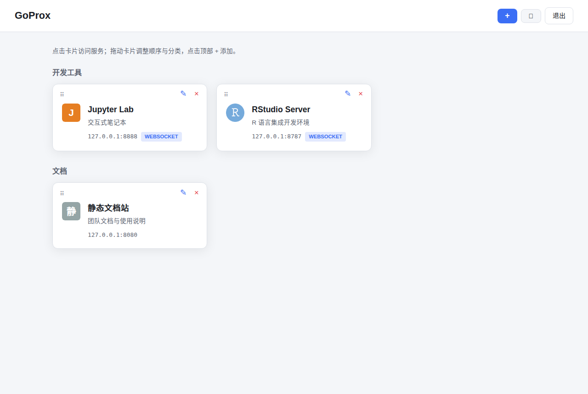
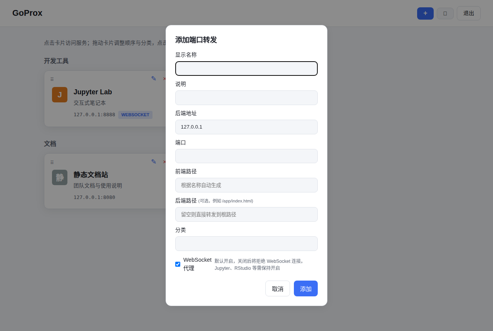

# GoProx

**一台服务器，一个 Web 入口，每人管理自己的 Jupyter / RStudio / 内网服务。**

GoProx 是面向实验室、登录节点的**多用户认证反向代理**网关，用 Go 语言编写。运维启动一个共享网关并创建用户账号，每个用户登录网页管理自己的转发（添加卡片、拖动排序），无需每人记不同端口。

## 安装

```bash
go install github.com/seqyuan/goprox@latest
```

安装后 `goprox` 位于 `$GOPATH/bin`（通常是 `~/go/bin`）。

> **重要：请把二进制拷贝（不是链接）到独立目录再运行。**
> 所有配置都存放在**二进制旁边的 `config/` 目录**，因此整个目录可以整体拷贝、备份、迁移。`os.Executable` 会解析符号链接，所以**不要用 `ln -s` 链接**，否则配置会落在链接目标的真实路径下。

```bash
mkdir -p /opt/goprox
cp ~/go/bin/goprox /opt/goprox/
```

如果 `go install` 后直接在 `~/go/bin` 里运行，配置会写在 `~/go/bin/config/`，也可以接受，但建议放到独立目录。

## 版本

`goprox --help` 第一行显示版本号。版本来自最近的 git tag，构建时注入：

```bash
make build        # 等价于 go build -ldflags "-X main.version=$(git describe --tags --abbrev=0)"
```

本地直接用 `go build` / `go install`（不带 ldflags）时版本显示为 `dev`。

## 快速开始

三步即可上线：

```bash
# ① 把 goprox 拷贝到独立目录（见「安装」）
cd /opt/goprox

# ② 管理员创建用户账号（交互式设置密码，一条命令一个用户）
./goprox user alice
./goprox user bob

# ③ 启动网关 —— 日常只需记住这一条命令
./goprox start --port 1908
```

- 浏览器访问 `http://lab.example.com:1908/`，用刚创建的账号登录；
- 登录后点 **+** 添加自己的服务卡片，拖动排序，点击卡片访问。

> **`--port` 只在第一次启动时需要指定**，之后端口会记录在 `config/state.yaml`，直接 `./goprox start` 即可。

## 日常管理（只需 4 条命令）

| 想做什么 | 命令 |
|---|---|
| 启动网关 | `./goprox start` |
| 查看运行状态 | `./goprox status` |
| 停止网关 | `./goprox stop` |
| 查看运行日志 | `tail -f config/goprox.log` |

> 日志目录即程序旁边的 `config/`（可用 `-d <dir>` 指定，见下方 Options）。

## serve 和 start 用哪个？

**二选一，日常用 `start`，`serve` 可以完全不用管。**

两者启动的是**同一个网关**，只是运行方式不同：

| | `start`（日常用） | `serve`（调试用） |
|---|---|---|
| 运行方式 | 后台运行，关闭终端也不影响 | 前台运行，占用当前终端 |
| 日志 | 写入 `config/goprox.log` | 直接打印到终端 |
| 停止方式 | `./goprox stop` | Ctrl+C |

- 想长期运行 → 用 `start`，然后该干嘛干嘛；
- 想在终端里实时看日志、排查问题 → 先 `./goprox stop` 停掉，再 `./goprox serve`。

> ⚠️ 两者共用同一端口，**不能同时运行**；重复启动会提示 `already running`，先 `stop` 再启动即可。

## 命令参考

```bash
# 日常使用
./goprox start [options]    启动网关（后台运行，日志写入 config/goprox.log）
./goprox stop               停止网关
./goprox status             查看运行状态

# 用户管理（管理员）
./goprox user <name>        创建用户账号（交互设置密码）
./goprox passwd <name>      重置用户密码
./goprox del <name>         删除用户账号

# 调试（可选，日常无需使用）
./goprox serve [options]    前台运行网关（日志打印到终端）

Options:
  -d, --config-dir <dir>  配置目录（默认 <程序目录>/config）
  --host <host>           监听地址（默认 0.0.0.0）
  --port <port>           监听端口（默认 1908）
  --trusted-proxy <cidr>  可信反向代理网段（如 127.0.0.1/32），
                          启用后信任其 X-Forwarded-For/Proto 头（默认不信任）
  -h, --help              显示帮助
```

`user` / `passwd` / `del` 需要与网关相同的目录写权限（root 启动的网关，管理命令也用 root 执行）。
> 这三个命令的用户名需写在选项**之前**：`goprox user alice -d /opt/goprox/config`，
> 不能写成 `goprox user -d ... alice`。

## 目录结构

```text
/opt/goprox/
├── goprox                  # 二进制
└── config/                 # 0700，网关属主
    ├── state.yaml          # 网关状态（监听地址/端口、trusted_proxy、session_secret）
    ├── daemon.pid          # 后台运行时存在
    ├── goprox.log          # 后台运行日志（goprox start 时）
    └── users/              # 每个用户一个独立配置文件
        ├── alice.yaml
        └── bob.yaml
```

多用户共享同一端口：登录后每个用户只能看到和管理自己的服务，访问路径为 `/proxy/<用户名>/<服务>/`。

## 配置文件

### 用户配置 (`config/users/<用户名>.yaml`)

```yaml
auth:
  password_hash: "$2a$10$YVpm1R6puQFltjmrKziLsujVtAJDJIynTC54yESGslrkmyP5ORBTO"  # bcrypt（goprox user/passwd 生成）
services:
  - id: jupyter
    name: "Jupyter Lab"
    description: "交互式笔记本"
    host: "127.0.0.1"
    port: 8888
    path: "/jupyter"
    websocket: true
    category: "开发工具"
    order: 0
    # bwlimit: 10485760              # 可选：该服务带宽上限（字节/秒，0/缺省 = 不限速）
    # backend_path: "/app/index.html"  # 可选：后端实际监听路径（见下方 BackendPath 说明）
```

#### 卡片（服务）参数一览

**仪表盘上的服务卡片**（点击卡片访问服务；✎ 编辑、× 删除、⋮⋮ 拖动排序）：



**添加 / 编辑服务的表单**（即卡片的全部可配置参数）：



> 在网页「+ 添加 / 编辑」弹窗、或 `/api/services` 接口中配置以上字段；`id`、`order` 由系统自动维护。

<details>
<summary>📋 文字版参数表（便于检索 / 复制）</summary>

| 参数 | 类型 | 必填 | 默认值 | 说明 |
|---|---|---|---|---|
| `name` | string | ✅ | — | 卡片显示名称（≤200 字符） |
| `host` | string | — | `127.0.0.1` | 后端地址，仅允许回环/私网（公网、链路本地/云元数据地址被拒） |
| `port` | int | ✅ | — | 后端端口（1–65535） |
| `path` | string | — | 按 `id` 自动生成 | 前端访问路径，如 `/jupyter`；仅允许 `A-Za-z0-9._~-` 与 `/`，同用户内唯一 |
| `backend_path` | string | — | 空 | 后端实际监听子路径/文件，如 `/app/index.html`（见下方 BackendPath 说明） |
| `websocket` | bool | — | `true` | 是否允许 WebSocket 升级（Jupyter/RStudio 需开启） |
| `bwlimit` | int | — | `0` | 该服务带宽上限（字节/秒），上行/下行各限 `bwlimit`，`0`/缺省 = 不限速 |
| `description` | string | — | 空 | 说明文字（≤500 字符） |
| `category` | string | — | 未分类 | 分类/分组名（≤100 字符） |
| `id` | string | — | 🔒 系统自动 | 服务唯一 ID，由名称自动生成，重名自动加 `-2`、`-3`… |
| `order` | int | — | 🔒 系统自动 | 排序号（新增 = 最大 order+1，拖拽排序时更新） |

</details>

> `password_hash` 为新版 `goprox user` / `goprox passwd` 生成的 **bcrypt** 哈希（`$2a$10$...`，示例值是口令 `change-me`）。
> 旧版遗留的 SHA-256 哈希兼容细节见下方「密码存储」。

### 网关状态 (`config/state.yaml`)

```yaml
server:
  host: "0.0.0.0"
  port: 1908
  # 仅在网关前面有反向代理时设置：
  # trusted_proxy: "127.0.0.1/32"
auth:
  session_secret: "<auto-generated>"
  session_ttl: 86400
```

> **安全说明**：默认不信任 `X-Forwarded-For` / `X-Forwarded-Proto`（直连客户端可伪造，
> 会导致登录限流失效与 Secure Cookie 异常）。只有在网关部署于可信反向代理之后时，
> 才设置 `trusted_proxy`（或用 `goprox start --trusted-proxy 127.0.0.1/32`）。
>
> **清除方法**：`trusted_proxy` 一旦写入会一直生效（与 `host`/`port` 相同的语义，
> 去掉启动参数不会清除它）。要关闭请编辑 `config/state.yaml`，删除 `trusted_proxy` 行
> 后重启网关。每次启动时日志会打印当前生效值（`trusted proxy: ...`），可据此确认。

### 密码存储

密码使用 **bcrypt** 哈希（`goprox user` / `goprox passwd` 生成）。旧版本遗留的
SHA-256 哈希仍可正常登录（自动兼容），建议在方便时用 `goprox passwd` 重置一遍。

### 管理 API 的 CSRF 防护

管理 API（增删改服务、调整布局）和登录接口会对浏览器请求校验 `Origin` 头：
跨站页面（钓鱼网站、恶意网页）发起的请求会被拒绝（403）。非浏览器客户端
（curl、脚本）不带 `Origin`，不受影响。

> **残余风险说明**：通过网关代理的后端服务与网关**同源**（同一主机/端口），
> 因此任何被代理页面中的脚本都可以像用户本人一样调用管理 API（浏览器自动携带
> 会话 cookie，且 Origin 天然同源）。请勿在网关后面代理不可信、可执行任意脚本的
> 应用；如需严格隔离，请把管理界面部署在独立的主机/端口（独立 origin）。
> 同理，登录成功后请勿在不可信服务页面中保持登录状态。

### 保留路径（命名空间冲突）

网关自身占用以下固定路径，**不会**转发给任何后端服务：

| 路径 | 用途 |
|---|---|
| `/login` | 网关登录页 / 登录提交 |
| `/logout` | 退出登录 |
| `/favicon.ico` | 网关自身图标 |
| `/api/services`、`/api/services/*` | 卡片增删改、布局调整的 REST API |
| `/proxy/*` | 服务代理前缀 |

如果某个后端应用也使用这些**绝对路径**（例如后端自己也有 `/login` 页面、或 `/api/services` 接口），浏览器会命中网关而非后端。此时应让后端改用不冲突的路径，或为其配置 base_url/basePath 使链接落在 `/proxy/<用户>/<服务路径>/` 之下。

## WebSocket 代理

Jupyter、RStudio 等需要 WebSocket 的服务，请保持卡片的 **WebSocket 开关开启**（网页添加时默认勾选；API 未提供该字段时也默认开启），或设置 `websocket: true`。

关闭此选项后，WebSocket 升级请求会被拒绝（返回 403），普通 HTTP 不受影响。

## 后端服务配置指南

GoProx 会自动向后端返回的 HTML 页面注入 `<base href="/proxy/<用户>/<服务路径>/">` 标签，
因此**未配置 base_url 的应用通常也能正常加载相对路径资源**（图片、JS、CSS）。
但如果后端生成的是**绝对路径**链接（如 `/lab`、`/api/...`），仍需配置服务的 base_url
使其与代理前缀一致，否则这类链接会落到网关根路径上。

> **绝对路径的兜底转发**：后端页面里的绝对路径（如 `/_next/static/...`、`/favicon.svg`、
> `/api/...`）会被浏览器解析到网关根路径；GoProx 会用「最近访问的服务」cookie 把这些
> 请求转发回对应后端，因此**初次加载和直接访问资源通常可用**。但该机制依赖会话与
> cookie，且在多服务切换、无 `Referer` 的请求等场景下只能按「最近访问的服务」猜测。
> 对于重度依赖绝对路径的单页应用，推荐配置 basePath/base_url 与代理前缀一致以获得
> 稳定行为。

### 单页应用（SPA / Next.js）

Next.js 等 SPA 会生成大量绝对路径（`/_next/static/...`、`/favicon.svg`、`/api/...`、
`/workspace` 等），未配置 `basePath` 时：

- 服务端重定向（`Location`）会被 GoProx 自动改写回代理前缀内，登录/跳转流程可用；
- 静态资源与 API 请求靠「最近访问的服务」cookie 兜底转发，首次访问与直链可用；
- 客户端路由（`<Link>` / `router.push`）基于浏览器当前路径，可能不受 `<base>` 影响，
  建议为后端配置与代理前缀一致的 `basePath`（Next.js）或 base_url（其他框架）。

```js
// next.config.js —— 仅当该后端固定由同一用户、同一 path 代理时可这样配置
module.exports = { basePath: '/proxy/<用户>/<服务路径>' };
```

> 多用户网关下每个用户的代理前缀不同，无法写死一个 `basePath`；此时优先依赖 GoProx
> 的兜底转发，并避免多个服务同时使用裸绝对路径资源的重负载页面。

### Jupyter Lab

```bash
jupyter lab \
  --ip=0.0.0.0 \
  --port=8888 \
  --NotebookApp.base_url='/proxy/<用户>/<服务路径>/' \
  --NotebookApp.token='' \
  --no-browser
```

或在 `~/.jupyter/jupyter_lab_config.py` 中：

```python
c.ServerApp.base_url = '/proxy/用户名/jupyter/'
c.ServerApp.token = ''
```

### Jupyter Notebook

```bash
jupyter notebook \
  --ip=0.0.0.0 \
  --port=8888 \
  --NotebookApp.base_url='/proxy/<用户>/<服务路径>/' \
  --NotebookApp.token='' \
  --no-browser
```

### RStudio Server

在 `/etc/rstudio/rserver.conf` 中：

```
www-address=127.0.0.1
www-port=8787
www-root-path=/proxy/<用户>/rstudio/
```

### Code Server (VS Code)

```bash
code-server \
  --bind-addr 127.0.0.1:8080 \
  --auth none \
  --base-path '/proxy/<用户>/code/'
```

> `--auth none` 表示不再单独认证，访问安全完全依赖 GoProx 网关层登录，请确保网关只监听可信网络。

> **注意**：将 `<用户>` 替换为 Linux 用户名，`<服务路径>` 替换为卡片中设置的 path 值。

### BackendPath（后端实际路径）

「前端路径 `path`」和「后端路径 `backend_path`」是两个不同概念：

| | 前端路径 `path` | 后端路径 `backend_path` |
|---|---|---|
| 是谁的路径 | 网关对外暴露的访问路径 | 后端服务自身实际监听的路径 |
| 用户是否可见 | 可见（浏览器地址栏） | 不可见（转发时拼接） |

转发规则：

```text
前端:  /proxy/<用户>/<path>/<剩余路径>
              ↓ 网关转发
后端:  <backend_path 或 根>/<剩余路径>
```

**三种典型配置：**

**① 后端挂在根目录（最常见，`backend_path` 留空）**

```yaml
services:
  - name: "Jupyter Lab"
    port: 8888
    path: "/jupyter"   # 前端路径
    # backend_path 留空
```

- 访问 `/proxy/alice/jupyter/` → 后端收到 `/`
- Jupyter / RStudio 等基本都是这种情况，留空即可。

**② 后端跑在某个子路径下**

后端 API 的所有路由都在 `/api/v1/...` 下：

```yaml
services:
  - name: "我的 API"
    port: 8000
    path: "/myapi"            # 前端路径
    backend_path: "/api/v1"   # 后端路径（目录前缀）
```

- 访问 `/proxy/alice/myapi/users` → 后端收到 `/api/v1/users`
- 访问 `/proxy/alice/myapi/` → 后端收到 `/api/v1`

**③ 后端静态站入口在某个文件**

后端静态站首页是 `/public/index.html`（不是 `/`）：

```yaml
services:
  - name: "静态站点"
    port: 8080
    path: "/docs"                       # 前端路径
    backend_path: "/public/index.html"  # 后端路径（文件）
```

- 访问 `/proxy/alice/docs/` → 后端收到 `/public/index.html`
- 访问 `/proxy/alice/docs/assets/app.js` → 后端收到 `/public/assets/app.js`

补充规则：

- `backend_path` 指向**文件**（含扩展名）时，子资源会解析到该文件所在目录；
- 后端重定向到该路径时，GoProx 会先剥离 `backend_path` 再拼接代理前缀。

> **怎么判断要不要填 `backend_path`**：先留空，直接访问看能否打开；若 404 或资源路径不对，说明后端不是挂在根路径，再把它的实际前缀/入口文件填进 `backend_path`。

## License

MIT
